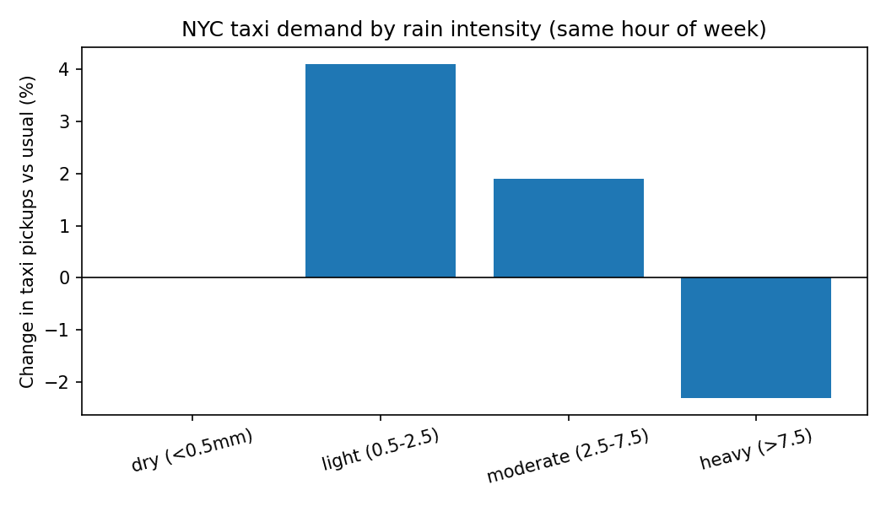
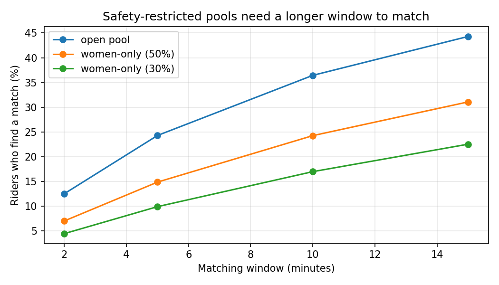
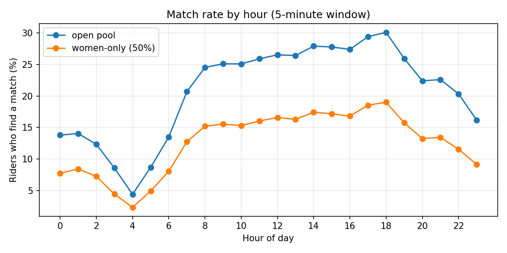
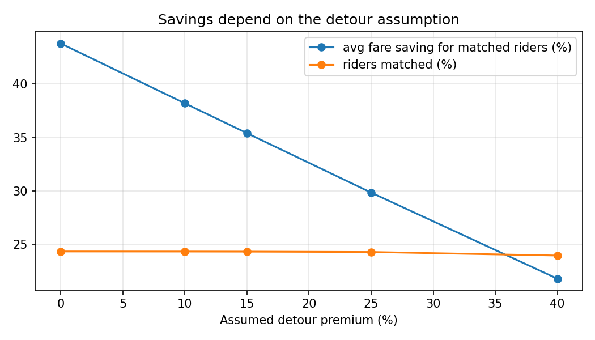

# Rain, Taxi Demand and Ride Pooling

When it rains, people struggle to get cabs. I wanted to know three things:

1. Does rain actually change taxi demand, and can weather improve a demand forecast?
2. If riders heading the same way shared cabs, how much could they save?
3. If the pool were **women-only** for safety, what would that cost in matches?

I used real NYC taxi data as a stand-in, since Uber and Ola trip data is not public.

## Key findings

| Question | Result |
|---|---|
| Does rain spike completed taxi trips? | Not much. Versus the usual demand for the same hour of the week: **+4.1%** in light rain, **+1.9%** in moderate rain, **-2.3%** in heavy rain. |
| Does rain improve a demand forecast? | **No.** A model with time + temperature cut error by about 17% over a time-only lookup, but adding rain features on top changed nothing measurable. |
| How much could pooling save? | With a 5-minute matching window, **24.3%** of riders find a match, each paying about **35%** less (range 22-44% depending on the detour assumption). About **12%** fewer cab trips are needed. |
| What does women-only pooling cost? | If women are 50% of riders, only **14.9%** find a match (vs 24.3% in an open pool). A women-only pool needs roughly **twice the waiting window** to match as often as an open one. |
| Is it worse at night? | Yes. Match rates at night (10pm-6am) are **8.9%** for women-only vs **16.0%** in the daytime, the lowest exactly when safety matters most. |

## Data

- **Trips:** NYC TLC yellow taxi trip records, January to June 2024.
- **Weather:** hourly precipitation and temperature from the Open-Meteo archive API for NYC.
- 4,368 hourly rows. An hour counts as rainy at 0.5 mm or more: 340 rainy hours (7.8%).

## Method

**1. Rain effect (`analyze_rain_effect.py`).** Rainy hours have different demand partly because rain often falls at busy times of day. To avoid that, each hour's trips are divided by the usual dry-weather demand for the same hour of day and day of week (so 6pm Tuesday is compared with other dry 6pm Tuesdays).

| Rain level | Hours | Change vs usual | Peak hours only |
|---|---|---|---|
| Light (0.5-2.5 mm) | 257 | +4.1% | +5.5% (81 hours) |
| Moderate (2.5-7.5 mm) | 69 | +1.9% | +4.1% (31 hours) |
| Heavy (>7.5 mm) | 14 | -2.3% | -3.5% (3 hours) |



**2. Does rain help a forecast? (`ablation.py`).** The same gradient-boosting model was trained on January to April and tested on unseen May and June, with different feature sets. Only the features change.

| Features | MAE all hours | MAE rainy hours |
|---|---|---|
| time only | 665.0 | 1084.1 |
| time + temperature | 554.2 | 954.5 |
| time + rain | 686.4 | 1026.6 |
| time + rain + temperature | 551.3 | 1009.5 |

Temperature explains the improvement, probably because it tracks the seasonal shift between the training and test months. Rain features did not help: adding them to the time-only model made overall error slightly worse (bootstrap 95% CI on the gain: [-34.4, -8.1]), and with temperature included the interval for all hours was [-7.0, +12.9], which includes zero.

**3. Pooling simulation (`pooling_sim.py`).** Using about 4.6 million single-rider trips from May and June:

- Trips with the same pickup zone, same dropoff zone and a pickup time in the same short window are grouped into shared cabs of up to 2 riders.
- The shared cab costs the longest rider's solo fare plus a 15% detour premium. Riders only pool if it is cheaper in total.
- The fare is split in proportion to each rider's solo fare, so everyone in a cab gets the same percentage discount.
- **Women-only pool:** the data has no gender field, so women are a random subset (50% or 30%, an assumption) who can only match each other.

| Matching window | Open pool | Women-only (50%) | Women-only (30%) |
|---|---|---|---|
| 2 min | 12.5% | 7.0% | 4.5% |
| 5 min | 24.3% | 14.9% | 9.9% |
| 10 min | 36.4% | 24.3% | 17.0% |



At a 5-minute window, open pooling also removes about 12.2% of cab trips and 7.1% of vehicle miles. Match rates are about the same in rainy and dry hours (rainy peak 25.8% vs dry peak 26.0%), consistent with rain not changing how many trips happen.

**4. Time of day and sensitivity (`charts.py`).** Matching is hardest overnight, and the women-only pool is thinnest then.



The match rate barely depends on the detour assumption, but the savings do: 43.8% at 0% detour premium, 35.4% at 15%, and 21.8% at 40%.



## Limitations

- **Completed trips, not unmet demand.** The data cannot show people who could not get a cab. Heavy rain may reduce completed trips because cabs are scarce or slow, so this analysis underestimates demand during storms.
- **Rain data is thin.** Only 14 hours were heavy rain, and rainy trips in the pooling analysis come from a small number of rainy hours, so they are not independent samples.
- **Yellow taxis only.** Most NYC ride-hail rides are Uber and Lyft, so real rider density, and so match rates, would be higher.
- **Strict matching rule.** Only riders with the same pickup and dropoff zones are matched, so potential savings are likely understated. Real matching could use nearby zones and en-route stops.
- **Assumptions drive the savings.** The detour premium, window and pool size are my choices (see the sensitivity analysis). The share of women riders is assumed, and gender is randomly assigned.
- **NYC is not Indian cities.** Results will differ with local density, fares and rider behaviour.

## How to run

```
pip install -r requirements.txt
python3 build_dataset.py        # downloads trips + weather, builds data/hourly_demand_weather.csv
python3 analyze_rain_effect.py  # rain effect and baseline vs model
python3 ablation.py             # does rain help the forecast?
python3 pooling_sim.py          # pooling and women-only simulation
python3 charts.py               # figures and night-time analysis
```

The trip files are large (about 50 MB each), so the `data` folder is not in the repository. `build_dataset.py` downloads them.

## Ideas for next steps

- Test whether a longer night-time window or matching across nearby zones lifts the women-only match rate.
- Forecast demand by pickup zone instead of citywide.
- Add a route-aware matching rule instead of same-zone matching.
